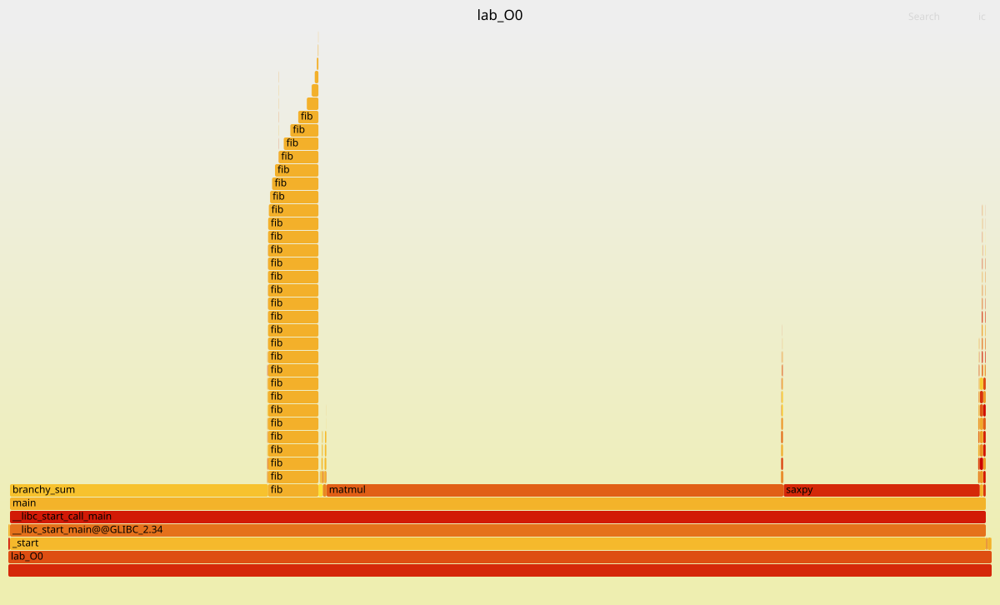
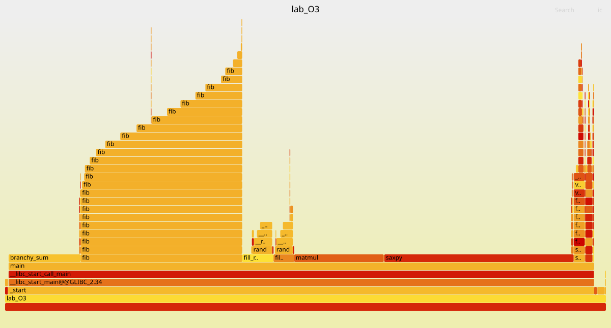
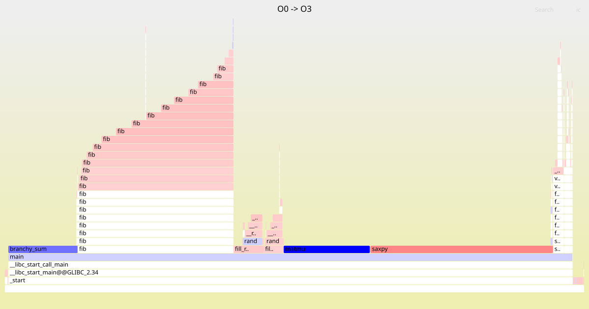

# Лабораторна робота: профілювання та оптимізація програми

Слобожанін Нікіта, ТК-32. Заміри зроблено 2026-11-21 10:36 скриптом `measure.sh`.

## Середовище

| Параметр | Значення |
|---|---|
| CPU | Intel(R) Core(TM) i7-6700HQ CPU @ 2.60GHz |
| SIMD-розширення CPU | avx avx2 fma sse4_2  |
| Ядро Linux | 7.0.0-43-generic |
| Компілятор | g++ (Ubuntu 15.2.0-16ubuntu1) 15.2.0 |
| perf | perf version 7.0.14 |

## Програма `lab.cpp`

| Функція | Що робить | Що показує |
|---|---|---|
| `matmul` | множення матриць 1024×1024, порядок i-k-j | обчислювальне навантаження, при -O3 векторизується (AVX2 + FMA) |
| `saxpy` | `y = a·x + y` на векторах по 16 МіБ | навантаження на пам'ять, SIMD допомагає менше |
| `branchy_sum` | сума елементів `≥ 128` випадкового масиву | непередбачуваний `if`, при -O3 замінюється маскою SIMD |
| `fib` | рекурсивне число Фібоначчі, k = 40 | глибокий стек викликів («вежа» на FlameGraph) |

Функції оголошені як `extern "C" __attribute__((noipa))`, щоб імена в perf/FlameGraph були простими і компілятор не вбудовував їх у `main`. Результати сумуються в `checksum`, тому компілятор не може викинути обчислення.

Збірка (`Makefile`):

| Бінарник | Флаги |
|---|---|
| `lab_O0` | `-O0 -g -fno-omit-frame-pointer` |
| `lab_O3` | `-O3 -march=native -g -fno-omit-frame-pointer` |

Запуск усіх замірів: `bash measure.sh`. Усі виводи лежать у папці [`results/`](results/).

Вивід програми `lab_O0` ([results/run_O0.txt](results/run_O0.txt)):

```text
[init  ]   0.168 s
[matmul]  10.310 s
[saxpy ]   4.549 s
[branch]   4.053 s
[fib   ]   0.887 s
[total ]  19.967 s
checksum = 4.830783e+10

```

Вивід програми `lab_O3` ([results/run_O3.txt](results/run_O3.txt)):

```text
[init  ]   0.161 s
[matmul]   0.272 s
[saxpy ]   0.635 s
[branch]   0.210 s
[fib   ]   0.487 s
[total ]   1.765 s
checksum = 4.830783e+10

```

---

## 1. FlameGraph

### 1.1 Побудова

```bash
perf record -F 499 --call-graph dwarf -o perf_O0.data ./lab_O0
perf script -i perf_O0.data | ~/FlameGraph/stackcollapse-perf.pl | ~/FlameGraph/flamegraph.pl > flame_O0.svg
```

`perf record` 499 разів на секунду записує стек викликів; `--call-graph dwarf` відновлює стек за debug-інформацією (`-g`). `stackcollapse-perf.pl` згортає однакові стеки в один рядок з кількістю, `flamegraph.pl` малює SVG.



Інтерактивна версія: відкрити [results/flame_O0.svg](results/flame_O0.svg) у браузері.

### 1.2 Інтерпретація

- Вісь Y — глибина стеку: знизу `main`, над ним функції, які він викликає.
- Ширина прямокутника — частка часу, коли функція була в стеку. Вісь X — алфавітний порядок, а не час.
- Плаский широкий верх — час іде в самій функції (власний час).
- `matmul` — найширший блок (46.32% власного часу): потрійний цикл, n³ ≈ 10⁹ множень на один виклик.
- `branchy_sum` — 26.15%: одне порівняння на елемент, але дані випадкові, тому предиктор переходів помиляється ~50% разів.
- `saxpy` — 19.78%: проста арифметика, обмежена швидкістю читання пам'яті.
- `fib` — 5.62%: вузька, але висока «вежа» — глибина рекурсії до 40.

---

## 2. Параметри виконання

### 2.1 `/usr/bin/time --verbose ./lab_O0`

```text
	Command being timed: "./lab_O0"
	User time (seconds): 18.57
	System time (seconds): 0.04
	Percent of CPU this job got: 99%
	Elapsed (wall clock) time (h:mm:ss or m:ss): 0:18.62
	Average shared text size (kbytes): 0
	Average unshared data size (kbytes): 0
	Average stack size (kbytes): 0
	Average total size (kbytes): 0
	Maximum resident set size (kbytes): 81772
	Average resident set size (kbytes): 0
	Major (requiring I/O) page faults: 0
	Minor (reclaiming a frame) page faults: 19621
	Voluntary context switches: 1
	Involuntary context switches: 204
	Swaps: 0
	File system inputs: 0
	File system outputs: 0
	Socket messages sent: 0
	Socket messages received: 0
	Signals delivered: 0
	Page size (bytes): 4096
	Exit status: 0

```

| Поле | Значення |
|---|---|
| `Elapsed (wall clock)` | реальний час від старту до кінця: 0:18.62 |
| `User time` ≈ `Elapsed` | програма весь час рахує на CPU, не чекає на диск чи мережу |
| `Maximum resident set size` | пікова пам'ять: 3 матриці по 4 МіБ + 2 вектори по 16 МіБ + масив 32 МіБ ≈ 80 МіБ |
| `context switches` | скільки разів ОС знімала процес з ядра |
| `Page faults` | звернення до нових сторінок пам'яті при першому записі у вектори |

Те саме для `lab_O3`:

```text
	Command being timed: "./lab_O3"
	User time (seconds): 1.79
	System time (seconds): 0.03
	Percent of CPU this job got: 99%
	Elapsed (wall clock) time (h:mm:ss or m:ss): 0:01.83
	Average shared text size (kbytes): 0
	Average unshared data size (kbytes): 0
	Average stack size (kbytes): 0
	Average total size (kbytes): 0
	Maximum resident set size (kbytes): 81632
	Average resident set size (kbytes): 0
	Major (requiring I/O) page faults: 0
	Minor (reclaiming a frame) page faults: 19622
	Voluntary context switches: 1
	Involuntary context switches: 22
	Swaps: 0
	File system inputs: 0
	File system outputs: 0
	Socket messages sent: 0
	Socket messages received: 0
	Signals delivered: 0
	Page size (bytes): 4096
	Exit status: 0

```

### 2.2 `perf stat -d ./lab_O0`

```text
# started on Sat Nov 21 10:34:10 2026


 Performance counter stats for './lab_O0':

               370      context-switches                 #     18.2 cs/sec  cs_per_second     
                 3      cpu-migrations                   #      0.1 migrations/sec  migrations_per_second
             19606      page-faults                      #    963.5 faults/sec  page_faults_per_second
          20349.52 msec task-clock                       #      1.0 CPUs  CPUs_utilized       
         332877882      L1-dcache-load-misses            #      0.6 %  l1d_miss_rate            (37.50%)
          10283649      LLC-loads                        #     33.0 %  llc_miss_rate            (25.00%)
         254920114      branch-misses                    #      4.3 %  branch_miss_rate         (25.00%)
        5949176862      branches                         #    292.3 M/sec  branch_frequency     (25.00%)
       48033831892      cpu-cycles                       #      2.4 GHz  cycles_frequency       (37.51%)
      120061104032      instructions                     #      2.5 instructions  insn_per_cycle  (37.50%)

      20.360096454 seconds time elapsed

      20.305164000 seconds user
       0.044998000 seconds sys


```

| Метрика | Формула / зміст |
|---|---|
| `cycles` | такти CPU; f ≈ cycles / t = - / 19.967 с ≈ 1000000000.00 ГГц |
| `instructions`, `insn per cycle` | IPC = instructions / cycles |
| `branch-misses` | % неправильно передбачених переходів (в основному `branchy_sum`) |
| `L1-dcache-load-misses` | % звернень, яких не було в кеші L1 (в основному `saxpy` і `matmul`) |

Те саме для `lab_O3`:

```text
# started on Sat Nov 21 10:34:33 2026


 Performance counter stats for './lab_O3':

                14      context-switches                 #      8.4 cs/sec  cs_per_second     
                 0      cpu-migrations                   #      0.0 migrations/sec  migrations_per_second
             19605      page-faults                      #  11803.6 faults/sec  page_faults_per_second
           1660.93 msec task-clock                       #      1.0 CPUs  CPUs_utilized       
         331110470      L1-dcache-load-misses            #     16.6 %  l1d_miss_rate            (37.41%)
         144079573      LLC-loads                        #     24.2 %  llc_miss_rate            (25.01%)
           5336751      branch-misses                    #      0.4 %  branch_miss_rate         (25.04%)
        1343884132      branches                         #    809.1 M/sec  branch_frequency     (25.04%)
        4616507780      cpu-cycles                       #      2.8 GHz  cycles_frequency       (37.56%)
        8506614396      instructions                     #      1.8 instructions  insn_per_cycle  (37.55%)

       1.662235617 seconds time elapsed

       1.618103000 seconds user
       0.044002000 seconds sys


```

### 2.3 `perf report`

```bash
perf report -i perf_O0.data --stdio --no-children -g none
```

```text
# To display the perf.data header info, please use --header/--header-only options.
#
#
# Total Lost Samples: 0
#
# Samples: 9K of event 'cpu/cycles/P'
# Event count (approx.): 51137145208
#
# Overhead  Command  Shared Object      Symbol                                                              
# ........  .......  .................  ....................................................................
#
    46.32%  lab_O0   lab_O0             [.] matmul
    26.15%  lab_O0   lab_O0             [.] branchy_sum
    19.78%  lab_O0   lab_O0             [.] saxpy
     5.62%  lab_O0   lab_O0             [.] fib
     0.25%  lab_O0   lab_O0             [.] fill_random_f(std::vector<float, std::allocator<float> >&)
     0.20%  lab_O0   libc.so.6          [.] __random_r
     0.20%  lab_O0   libc.so.6          [.] __random
     0.18%  lab_O0   lab_O0             [.] void std::__fill_a1<float*, float>(float*, float*, float const&)
     0.14%  lab_O0   lab_O0             [.] void std::__fill_a1<int*, int>(int*, int*, int const&)
     0.12%  lab_O0   [kernel.kallsyms]  [k] __irqentry_text_end
     0.12%  lab_O0   lab_O0             [.] fill_random_i(std::vector<int, std::allocator<int> >&)
     0.10%  lab_O0   libc.so.6          [.] rand
     0.08%  lab_O0   [kernel.kallsyms]  [k] error_entry
     0.04%  lab_O0   [kernel.kallsyms]  [k] sync_regs
     0.04%  lab_O0   [kernel.kallsyms]  [k] native_irq_return_iret
     0.03%  lab_O0   [kernel.kallsyms]  [k] update_cfs_group
     0.03%  lab_O0   [kernel.kallsyms]  [k] __rcu_read_unlock
     0.03%  lab_O0   [kernel.kallsyms]  [k] mas_walk
     0.03%  lab_O0   [kernel.kallsyms]  [k] update_se

```

Колонка `Overhead` — власний час функції (без дочірніх). Повний вивід: [results/report_O0.txt](results/report_O0.txt).

По бібліотеках (`--sort dso`):

```text
# To display the perf.data header info, please use --header/--header-only options.
#
#
# Total Lost Samples: 0
#
# Samples: 9K of event 'cpu/cycles/P'
# Event count (approx.): 51137145208
#
# Overhead  Shared Object    
# ........  .................
#
    98.59%  lab_O0           
     0.90%  [kernel.kallsyms]
     0.50%  libc.so.6        
     0.01%  [alcor_pci]      
     0.00%  [kvm]            


#
# (Cannot load tips.txt file, please install perf!)
#

```

98.59% часу — у самому `lab_O0`, решта — ядро Linux і libc.

Те саме для `lab_O3` ([results/report_O3.txt](results/report_O3.txt)):

```text
# To display the perf.data header info, please use --header/--header-only options.
#
#
# Total Lost Samples: 0
#
# Samples: 910  of event 'cpu/cycles/P'
# Event count (approx.): 4648846307
#
# Overhead  Command  Shared Object         Symbol                                                        
# ........  .......  ....................  ..............................................................
#
    30.99%  lab_O3   lab_O3                [.] saxpy
    28.44%  lab_O3   lab_O3                [.] fib
    14.99%  lab_O3   lab_O3                [.] matmul
    11.75%  lab_O3   lab_O3                [.] branchy_sum
     4.01%  lab_O3   libc.so.6             [.] __random_r
     2.38%  lab_O3   libc.so.6             [.] __random
     1.49%  lab_O3   lab_O3                [.] fill_random_f(std::vector<float, std::allocator<float> >&)
     0.82%  lab_O3   [kernel.kallsyms]     [k] __irqentry_text_end
     0.58%  lab_O3   libc.so.6             [.] __memset_avx2_unaligned_erms
     0.47%  lab_O3   [kernel.kallsyms]     [k] error_entry
     0.46%  lab_O3   [kernel.kallsyms]     [k] kernel_init_pages
     0.44%  lab_O3   lab_O3                [.] rand@plt
     0.33%  lab_O3   libc.so.6             [.] rand
     0.33%  lab_O3   [kernel.kallsyms]     [k] native_irq_return_iret
     0.22%  lab_O3   lab_O3                [.] fill_random_i(std::vector<int, std::allocator<int> >&)
     0.21%  lab_O3   [kernel.kallsyms]     [k] timerqueue_add
     0.15%  lab_O3   [kernel.kallsyms]     [k] lru_add
     0.15%  lab_O3   [kernel.kallsyms]     [k] handle_mm_fault
     0.15%  lab_O3   [kernel.kallsyms]     [k] arch_exit_to_user_mode_prepare.isra.0

```

---

## 3. Енергія

Вимірювання через Intel RAPL (лічильники енергії всередині CPU), кожен замір повторено 3 рази (`-r 3`), в таблицях — середнє:

```bash
perf stat -a -r 3 -e power/energy-pkg/,power/energy-cores/,power/energy-ram/ sleep 10      # простій
perf stat -a -r 3 -e power/energy-pkg/,power/energy-cores/,power/energy-ram/ ./lab_O0
```

| Домен | Що міряє |
|---|---|
| `energy-pkg` | весь процесор (ядра + кеш + контролер пам'яті + вбудована графіка) |
| `energy-cores` | лише ядра, це частина `pkg`, тому окремо не додається |
| `energy-ram` | модулі оперативної пам'яті |

### 3.1 Енергія системи

Простій ([results/energy_idle.txt](results/energy_idle.txt)):

```text
# started on Sat Nov 21 10:34:40 2026


 Performance counter stats for 'system wide' (3 runs):

             12.95 Joules power/energy-pkg/                                                       ( +- 18.55% )
              6.09 Joules power/energy-cores/                                                     ( +- 22.98% )
              7.91 Joules power/energy-ram/                                                       ( +-  3.78% )

      10.009043551 +- 0.001627263 seconds time elapsed  ( +-  0.02% )


```

Під час `lab_O0` ([results/energy_O0.txt](results/energy_O0.txt)):

```text
# started on Sat Nov 21 10:35:10 2026


 Performance counter stats for 'system wide' (3 runs):

            221.74 Joules power/energy-pkg/                                                       ( +-  4.47% )
            197.61 Joules power/energy-cores/                                                     ( +-  5.42% )
             15.47 Joules power/energy-ram/                                                       ( +-  1.94% )

      16.736072248 +- 0.611650813 seconds time elapsed  ( +-  3.65% )


```

Під час `lab_O3` ([results/energy_O3.txt](results/energy_O3.txt)):

```text
# started on Sat Nov 21 10:36:00 2026


 Performance counter stats for 'system wide' (3 runs):

             18.81 Joules power/energy-pkg/                                                       ( +-  4.65% )
             15.71 Joules power/energy-cores/                                                     ( +-  5.98% )
              2.97 Joules power/energy-ram/                                                       ( +-  1.33% )

       1.691144272 +- 0.049162244 seconds time elapsed  ( +-  2.91% )


```

```text
E_sys = E_pkg + E_ram
E_sys(O0) = 221.74 + 15.47 = 237.21 Дж
E_sys(O3) = 18.81 + 2.97 = 21.78 Дж
```

### 3.2 Енергія самої програми

`perf stat -a` рахує всю систему, тому віднімаю те, що система споживає без програми:

```text
P_idle = (E_pkg + E_ram)_idle / t_idle = (12.95 + 7.91) / 10.009043551 = 2.08 Вт

E_prog = E_sys − P_idle · t
E_prog(O0) = 237.21 − 2.08 · 16.736072248 = 202.40 Дж
E_prog(O3) = 21.78 − 2.08 · 1.691144272 = 18.26 Дж
```

Обмеження: RAPL не бачить дискретну відеокарту, дисплей і інші пристрої; вони під час тесту не навантажені, тому входять у `P_idle`.

---

## 4. -O0 проти -O3 -march=native

### 4.1 Асемблер

Повні лістинги: [asm/lab_O0.objdump.txt](asm/lab_O0.objdump.txt), [asm/lab_O3.objdump.txt](asm/lab_O3.objdump.txt).

`matmul`, -O0 — скалярні інструкції, 1 float за раз, кожна змінна йде через стек (`[rbp-…]`):

```text
    14d9:	movss  DWORD PTR [rax],xmm0
    1523:	movss  xmm0,DWORD PTR [rax]
    1527:	movss  DWORD PTR [rbp-0x4],xmm0
    1554:	movss  xmm1,DWORD PTR [rax]
    1577:	movss  xmm0,DWORD PTR [rax]
    157b:	mulss  xmm0,DWORD PTR [rbp-0x4]
    159f:	addss  xmm0,xmm1
    15a3:	movss  DWORD PTR [rax],xmm0

```

`matmul`, -O3 -march=native — 8 float за інструкцію в регістрах `ymm` (256 біт):

```text
    1a8d:	vbroadcastss ymm1,DWORD PTR [rdi+0x4]
    1a97:	vbroadcastss ymm2,xmm3
    1ac0:	vmovups ymm0,YMMWORD PTR [r8+rax*1]
    1ac6:	vfmadd213ps ymm0,ymm2,YMMWORD PTR [r15+rax*1]
    1acc:	vfmadd231ps ymm0,ymm1,YMMWORD PTR [rdx+rax*1]
    1ad2:	vmovups YMMWORD PTR [r15+rax*1],ymm0
    1b11:	vbroadcastss xmm1,xmm3
    1b31:	vbroadcastss xmm0,DWORD PTR [r14+r11*4]

```

`branchy_sum`, -O0 — справжній умовний перехід:

```text
    1690:	add    rax,rdx
    1695:	cmp    eax,0x7f
    1698:	jle    16b5 <branchy_sum+0x57>
    16aa:	add    rax,rdx
    16b1:	add    QWORD PTR [rbp-0x10],rax
    16b5:	add    QWORD PTR [rbp-0x8],0x1
    16be:	cmp    rax,QWORD PTR [rbp-0x20]

```

`branchy_sum`, -O3 — `if` замінено маскою: `vpcmpgtd` порівнює 8 чисел, `vpand` обнуляє непотрібні, `vpaddq` додає. Переходу немає, отже немає й помилок передбачення:

```text
    1f88:	vpcmpgtd ymm0,ymm1,ymm5
    1f8c:	vpmovsxdq ymm4,xmm1
    1f97:	vpmovsxdq ymm1,xmm1
    1f9c:	vpmovsxdq ymm2,xmm0
    1fa7:	vpand  ymm2,ymm2,ymm4
    1fab:	vpmovsxdq ymm0,xmm0
    1fb0:	vpaddq ymm3,ymm2,ymm3
    1fb4:	vpand  ymm0,ymm0,ymm1

```

#### 4.1.1 AVX / SIMD

`-march=native` дозволяє компілятору використати всі розширення цього CPU (AVX2, FMA). Звіт GCC (`make vecreport`), які цикли векторизовано:

```text
lab.cpp:35:31: optimized: loop vectorized using 32 byte vectors
lab.cpp:35:31: optimized: loop vectorized using 16 byte vectors
lab.cpp:35:31: optimized: loop vectorized using 32 byte vectors
lab.cpp:35:31: optimized: loop vectorized using 16 byte vectors
lab.cpp:41:26: optimized: loop vectorized using 32 byte vectors
lab.cpp:41:26: optimized: loop vectorized using 16 byte vectors
lab.cpp:47:26: optimized: loop vectorized using 32 byte vectors
lab.cpp:47:26: optimized: loop vectorized using 16 byte vectors

```

| Інструкція | Що робить |
|---|---|
| `vbroadcastss ymm, [..]` | копіює одне число `A[i][k]` у всі 8 слотів регістра |
| `vfmadd231ps ymm1, ymm2, [..]` | `ymm1 += ymm2 · mem` для 8 float за одну інструкцію (FMA) |
| `vpcmpgtd` | порівняння 8 int одночасно → маска |
| `vpand`, `vpaddq` | застосування маски і додавання до суми |

### 4.2 Метрики до і після

| Метрика | lab_O0 | lab_O3 | O0/O3 |
|---|---:|---:|---:|
| [total] з програми, с | 19.967 | 1.765 | 11.31 |
| User time, с | 18.57 | 1.79 | 10.37 |
| Max resident set, KB | 81772 | 81632 | 1.00 |
| cycles | - | - | - |
| instructions | 120061104032 | 8506614396 | 14.11 |
| IPC (insn per cycle) | - | - | - |
| branch-misses, % | 4.3 | 0.4 | 10.75 |
| L1-dcache-loads | - | - | - |
| L1-dcache-load-misses, % | 0.6 | 16.6 | 0.04 |


Час по функціях (з виводу програми) і частка в `perf report`:

| Функція | O0, с | O3, с | Прискорення O0/O3 | Частка в perf report O0 | Частка в perf report O3 |
|---|---:|---:|---:|---:|---:|
| init (fill_random_f, _i) | 0.168 | 0.161 | 1.04× | 0.37% | 1.71% |
| matmul | 10.310 | 0.272 | 37.90× | 46.32% | 14.99% |
| saxpy | 4.549 | 0.635 | 7.16× | 19.78% | 30.99% |
| branchy_sum | 4.053 | 0.210 | 19.30× | 26.15% | 11.75% |
| fib | 0.887 | 0.487 | 1.82× | 5.62% | 28.44% |


- Загальне прискорення ≈ 11.31× (19.967 с → 1.765 с).
- `matmul` і `branchy_sum` прискорились найбільше: AVX2/FMA обробляє 8 значень за інструкцію, а `if` зник разом з помилками передбачення.
- `saxpy` прискорився менше: обмеження — пропускна здатність пам'яті, а не обчислення.
- `fib` не векторизується; прискорення лише від того, що змінні в регістрах, а не в стеку.
- Кількість інструкцій зменшилась в 14.11 разів: одна AVX-інструкція замінює 8 скалярних.

### 4.3 Зміни FlameGraph

FlameGraph `lab_O3`:



Частки змінились: `matmul` 46.32% → 14.99%, `branchy_sum` 26.15% → 11.75%, `saxpy` 19.78% → 30.99%, `fib` 5.62% → 28.44%. Після оптимізації вузьким місцем стає робота з пам'яттю (`saxpy`).

Диференційний FlameGraph (`difffolded.pl -n`, частки нормовані):

```bash
difffolded.pl -n a.folded b.folded | flamegraph.pl > flame_diff.svg
```



Синій — частка часу функції зменшилась після оптимізації, червоний — збільшилась.

### 4.4 Енергія до і після

| Величина | lab_O0 | lab_O3 | O0/O3 |
|---|---:|---:|---:|
| t (середнє з 3), с | 16.736072248 | 1.691144272 | 9.90 |
| E_pkg, Дж | 221.74 | 18.81 | 11.79 |
| E_cores, Дж | 197.61 | 15.71 | 12.58 |
| E_ram, Дж | 15.47 | 2.97 | 5.21 |
| E_sys = E_pkg + E_ram, Дж | 237.21 | 21.78 | 10.89 |
| P_avg = E_sys / t, Вт | 14.17 | 12.88 | 1.10 |
| E_prog = E_sys − P_idle·t, Дж | 202.40 | 18.26 | 11.08 |


```text
E = P_avg · t
E_sys(O0) / E_sys(O3)   = 237.21 / 21.78 ≈ 10.89
E_prog(O0) / E_prog(O3) = 202.40 / 18.26 ≈ 11.08
```

Середня потужність: 14.17 Вт (O0) і 12.88 Вт (O3), обидві версії завантажують одне ядро на 100%. Час скоротився в 11.31 разів, тому енергія на один запуск зменшилась в 10.89 разів.

---

## Висновки

1. FlameGraph і `perf report` показали гарячі місця: `matmul`, `branchy_sum`, `saxpy`.
2. `-O3 -march=native` дав прискорення ≈ 11.31× завдяки AVX2/FMA (8 float за інструкцію) і заміні `if` на SIMD-маски.
3. Енергія системи на запуск зменшилась ≈ 10.89×, енергія самої програми ≈ 11.08×: E = P·t, і головний внесок дає скорочення часу.
4. Після оптимізації обмеженням лишається пропускна здатність пам'яті (`saxpy`).
